<div align="center">



<br/>

[](https://linkedin.com/in/muhammad-alamdar-mehdi-9004a11b8)
[](mailto:rizvialamdar2@gmail.com)

</div>

## 👋 About me

Senior PHP backend engineer with **6+ years** building eCommerce, marketplace and SaaS systems. I connect marketplaces, CMS platforms, warehouses, accounting tools and courier services, and I like owning a module end to end, from architecture to production.

- 📍 Karachi, Sindh, Pakistan
- 🎓 MSc Software Engineering @ FAST NUCES (in progress)
- 🔧 Currently building microservices for a construction-procurement SaaS (PHP 8 + Slim)

## 🛠 Tech stack


<details>
<summary><b>🔌 Integrations I've worked with</b> (click to expand)</summary>

<br/>

| Area | Platforms |
| --- | --- |
| Marketplaces | eBay, Walmart |
| Storefronts / CMS | Shopify, Magento, WooCommerce, PrestaShop, WordPress |
| Accounting | QuickBooks, Sage |
| Couriers | FedEx, UPS, USPS, Canada Post, Australia Post |
| Payments | Stripe (subscriptions) |

</details>

<details>
<summary><b>🧩 What I've built</b> (click to expand)</summary>

<br/>

- **Multi-channel integration platform:** product, stock, price and order sync across marketplaces and CMS platforms
- **Product Management Module (Yii2):** bulk product uploads via spreadsheet import and UI workflows
- **Real-time job processing service (Node.js):** cron-style jobs dispatched and processed in real time
- **Procurement SaaS microservices (PHP 8 + Slim):** account, project and document services

</details>

<details>
<summary><b>🧪 A taste of how I write code</b> (click to expand)</summary>

```php
<?php

interface ChannelAdapter
{
    public function pushStock(string $sku, int $qty): void;
    public function pushPrice(string $sku, Money $price): void;
}

final class StockSync
{
    /** @param ChannelAdapter[] $channels */
    public function __construct(private array $channels) {}

    public function run(string $sku, int $qty): void
    {
        foreach ($this->channels as $channel) {
            $channel->pushStock($sku, $qty);
        }
    }
}
```

</details>

## ⭐ Featured Project

### [PHP Slim Project Service API](https://github.com/alamdar110/php-slim-project-service-api)

A PHP 8 + Slim backend API demo built to demonstrate clean backend service structure, REST endpoints, Docker setup, MySQL migrations, and PHPUnit tests.

**Highlights:**

- PHP 8 + Slim REST API
- Dockerized local environment
- MySQL database migrations and seed data
- Service/repository layering
- Workflow-oriented backend APIs with modular service structure, document handling flows, and role-based operations
- PHPUnit test coverage
- Clean README and local setup documentation

## 🎯 Portfolio Focus

This GitHub profile is focused on backend engineering projects that demonstrate:

- PHP API development with clean service structure
- Dockerized local development environments
- MySQL-backed workflows and migrations
- REST API design and third-party integration patterns
- eCommerce channel sync concepts such as products, stock, orders, pricing, and retryable jobs

<div align="center">

<sub>Open to remote backend opportunities · PHP · Laravel · Yii2 · Microservices</sub>

</div>
